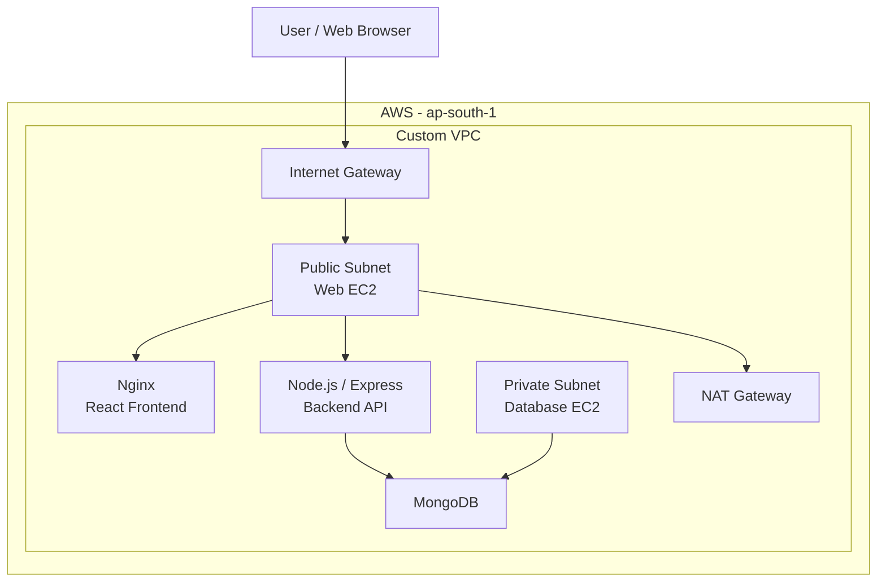

# MERN Application Deployment Using Terraform and Ansible

## Project Overview

This project demonstrates the deployment of the TravelMemory application on AWS using Terraform for infrastructure provisioning and Ansible for configuration management and application deployment.

The objective is to provision the required AWS infrastructure, configure MongoDB, deploy the Node.js backend, serve the React frontend using Nginx, and verify application connectivity.

## Technology Stack

- **Cloud:** AWS
- **Infrastructure as Code:** Terraform
- **Configuration Management:** Ansible
- **Frontend:** React
- **Backend:** Node.js and Express
- **Database:** MongoDB
- **Web Server and Reverse Proxy:** Nginx
- **Operating System:** Ubuntu 22.04
- **Region:** Asia Pacific (Mumbai), `ap-south-1`

## Architecture



Terraform provisions the VPC, public and private subnets, routing, security groups, EC2 instances, IAM roles, and related networking resources.

Ansible configures MongoDB on the database instance and deploys the backend and frontend on the web instance. Nginx serves the React application and proxies `/api/` requests to the backend.

## Repository Structure

```text
mern-terraform-ansible-app/
├── ansible/
│   ├── ansible.cfg
│   ├── inventory.ini
│   ├── mongodb.yml
│   ├── backend.yml
│   └── frontend.yml
├── app-source/
│   ├── backend/
│   └── frontend/
├── docs/
│   └── screenshots/
├── infra/
│   └── terraform/
│       ├── versions.tf
│       ├── provider.tf
│       ├── variables.tf
│       ├── terraform.tfvars
│       ├── network.tf
│       ├── security.tf
│       ├── network-security.tf
│       ├── compute.tf
│       └── iam.tf
├── .gitignore
└── README.md
```

Some local Terraform files, including `terraform.tfvars`, state files, and plan files, are intentionally excluded from version control.

## Prerequisites

- An AWS account with appropriate permissions
- AWS CLI configured with credentials
- Terraform installed
- Ansible installed on the control machine
- SSH access to the EC2 web instance
- The application source code

## Deployment Procedure

### 1. Provision AWS Infrastructure

```bash
cd infra/terraform

terraform init
terraform fmt
terraform validate
terraform plan -out=assignment.tfplan
terraform apply assignment.tfplan
```

Review the Terraform plan before applying it. Record the generated instance addresses and update the Ansible inventory as required.

### 2. Configure Ansible Connectivity

Update the local `ansible/inventory.ini` with the current web instance address, database private address, SSH user, private-key path, and SSH ProxyCommand for the private database. This file is intentionally ignored by Git.

The database instance is reached through the web instance using SSH ProxyCommand because the database is in a private subnet.

Verify connectivity:

```bash
cd ../../ansible

# Create your local inventory from the safe template
cp inventory.example.ini inventory.ini
# Edit inventory.ini with your actual IPs, SSH key path, and ProxyCommand

ansible all -m ping
```

### 3. Deploy MongoDB

```bash
ansible-playbook mongodb.yml
```

Verify MongoDB is running on the database instance:

```bash
ansible database -b -m shell -a \
"systemctl is-active mongod"
```

### 4. Deploy the Backend

```bash
ansible-playbook backend.yml
```

Verify the backend health endpoint:

```bash
ansible web -b -m shell -a \
"curl -i http://127.0.0.1:3001/hello"
```

### 5. Deploy the Frontend

Build the frontend with the API base path configured for the Nginx reverse proxy:

```bash
cd ../app-source/frontend
REACT_APP_BACKEND_URL=/api npm run build
```

Deploy the frontend:

```bash
cd ../../ansible
ansible-playbook frontend.yml
```

### 6. Verify the Application

Open the web instance's public IP address in a browser:

```text
http://<WEB_INSTANCE_PUBLIC_IP>
```

Verify the frontend and backend API through Nginx:

```bash
curl -i http://<WEB_INSTANCE_PUBLIC_IP>/
curl -i http://<WEB_INSTANCE_PUBLIC_IP>/api/hello
curl -i http://<WEB_INSTANCE_PUBLIC_IP>/api/trip
```

Expected results from the deployment verification:
- Frontend responds with HTTP 200.
- `/api/hello` responds with HTTP 200 and `Hello World!`.
- `/api/trip` responds with HTTP 200 and returns the trips collection.

## Evidence

Screenshots are stored in `docs/screenshots/` when available.

Recommended evidence:
- Terraform infrastructure and EC2 instances
- Successful Ansible execution for MongoDB
- Successful backend deployment and API response
- Successful frontend deployment
- TravelMemory application in a browser
- API endpoint verification

## Security Notes

- The database instance is placed in a private subnet.
- Security groups restrict database connectivity to the intended application tier.
- SSH access and inventory addresses must be maintained as instance public IPs can change.
- Do not commit AWS credentials, private keys, `.env` files, Terraform state, or Terraform plan files.
- Configure MongoDB authentication and production-grade secrets management before using this architecture beyond the assignment.

## Cleanup and Cost Management

AWS resources such as EC2 instances, NAT Gateway, and public IPv4 addresses can incur charges while allocated or running. Stop using the infrastructure only after collecting the required evidence.

To remove the Terraform-managed resources:

```bash
cd infra/terraform
terraform destroy
```

Review the destruction plan and confirm the target resources before proceeding. Keep the Terraform state available until destruction has completed successfully.

## Learning Outcomes

- Provisioning AWS infrastructure using Terraform
- Configuring network segmentation and security groups
- Using Ansible inventory and playbooks
- Deploying MongoDB and a Node.js backend
- Building and serving a React frontend with Nginx
- Configuring reverse proxy routing
- Verifying application connectivity and HTTP responses
- Managing infrastructure cleanup to control cloud costs
